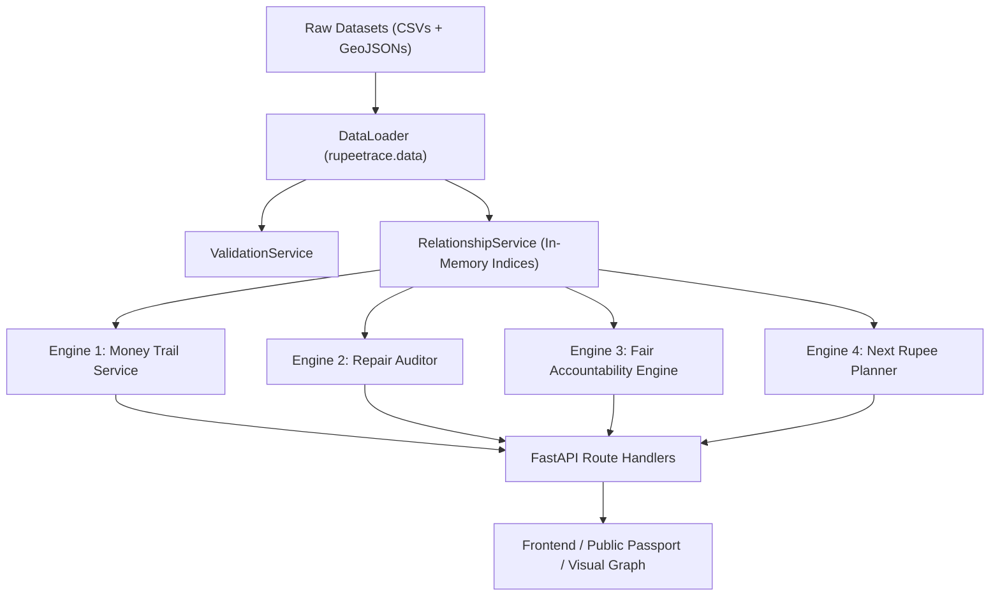

# RupeeTrace: Backend Architecture (Phase 1 & 2)

RupeeTrace is architected as a modular, high-performance Python FastAPI service. It implements deterministic financial accounting without relying on nondeterministic LLM math.

---

## 1. Architectural Principles

1. **Deterministic Financial Computations**: All aggregations, rate card deviation calculations, and priority scores are computed via deterministic Python services. LLMs are never used as arithmetic engines.
2. **Single-Scan In-Memory Indexing**: All datasets and relationships are ingested and normalized once at application startup. Subsequent lookups operate in $O(1)$ time via in-memory hash tables.
3. **Strict Evidence Provenance**: Every entity, finding, and recommendation preserves `SourceProvenance` (`source_file`, `source_record_id`, `row_index`) enabling complete auditability.
4. **Zero Silent Discard**: Incomplete or missing fields are converted to neutral placeholders without dropping source records.
5. **No Heavy Database Overhead**: Clean in-memory models prevent deployment friction for hackathon evaluation while providing microsecond response times.

---

## 2. Package Directory Layout

```
rupeetrace/
├── core/
│   ├── config.py             # System paths, environment overrides, API settings
│   └── provenance.py         # SourceProvenance model for evidence traceability
├── data/
│   ├── data_loader.py        # Centralized CSV & GeoJSON loader and type coercer
│   └── validation_service.py # Full schema, constraint, and relational validator
├── models/
│   └── entities.py           # Normalized domain entities (Pydantic v2)
├── schemas/
│   └── api_schemas.py        # API contract response models
├── services/
│   ├── relationship_service.py # In-memory indexing & graph link engine
│   ├── ward_service.py         # Ward budget tracking & metrics
│   ├── road_service.py         # Road asset condition & overlays
│   ├── work_order_service.py   # Work order queries & audit evidence
│   ├── money_trail_service.py  # Engine 1: Financial reconciliation
│   ├── audit_service.py        # Engine 2: 4-rule repair auditor
│   ├── accountability_service.py # Engine 3: Contractor scorecards
│   └── next_rupee_service.py   # Engine 4: Transparent prioritization planner
├── api/
│   └── routes/
│       ├── health.py         # System status & ingestion stats
│       ├── wards.py          # Ward summaries, detail, money trail, next rupee
│       ├── roads.py          # Road assets, work orders, complaints, financial history
│       ├── work_orders.py    # Work order records & audit evidence bundle
│       ├── audits.py         # Audit findings query and detail
│       └── contractors.py    # Contractor list & contextual scorecards
└── main.py                   # FastAPI factory, lifecycle hook, router registration
```

---

## 3. Data Flow Architecture



---

## 4. Performance & Caching Strategy

- **Startup Precomputation**: `lifespan` hook runs `loader.load_all()`, `run_full_validation()`, and builds dictionary maps (`roads_by_id`, `work_orders_by_road`, etc.).
- **Audit Findings Caching**: Audit findings are screened once at startup and stored in memory. Filtering by ward, contractor, or severity performs in-memory list filtering in sub-millisecond time.
- **Fast Duplicate Search**: Work order duplication detection pre-computes timestamps once and applies a windowed early `break` on sorted chronological order, reducing comparison time to $<0.05\text{ s}$.
