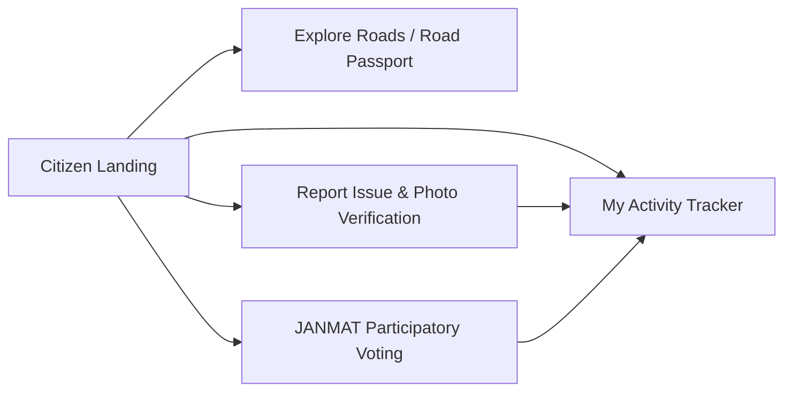

# RupeeTrace — Citizen User Journey & Workflow Specification

## 1. Persona Profile
- **Name**: Sunita Sharma
- **Identity**: Resident of Ward K/East (Andheri East / Marol)
- **Primary Goal**: Track tax expenditure on local roads, report surface defects with photographs, verify repair quality to protect public escrows, and vote on upcoming road improvement projects.
- **Authentication**: Token-authenticated Citizen Session (`sunita_sharma` / `cit_token_demo_sunita_2025`).

---

## 2. End-to-End Workflow Stages

### Stage 1: Citizen Landing (`/citizen-home`)
- **Headline Welcome**: "Welcome, Sunita Sharma (Ward K/E Resident)".
- **Ward Context**: Real-time monetary summary of Ward K/East repair allocations.
- **Search Bar**: Instant road lookup by street name (e.g., "Marol Maroshi Road") or Road ID ("RD0140").
- **4 Action Cards**: Direct entry points to Road Passports, 7-Stage Verification, JANMAT Voting, and Ward Financial Transparency.
- **Neighborhood Streets**: Grid of 8 local ward streets with live DLP warranty status tags.

### Stage 2: Explore Roads (`/explore-roads` / `#/passport/:road_id`)
- **Public Provenance**: Segment classification, surface engineering (Mastic Asphalt / CC), last resurfaced date.
- **Citizen History**: Chronological log of anonymized complaints filed by neighbors.
- **Repairs & Scope**: Historical work orders with contractor names and sanctioned amounts.
- **Public Warranty Status**: Plain-language 2-year warranty status and escrow defense guidelines without confusing algorithmic code audits.
- **Citizen Dialogue**: Public official responses provided by the ward executive engineer.

### Stage 3: Report Issue & 7-Stage Verification (`/report-issue`)
- **Before/After Verification**: Inspect contractor-uploaded completion photographs alongside actual ground conditions.
- **Escrow Confirmation**: If repair is level with manholes and curbs, click "Confirm Satisfactory".
- **Discrepancy Conflict Flag**: If unbonded asphalt or loose gravel is observed, click "Flag Discrepancy" to withhold 10-30% contractor retainage escrow.
- **Issue Submission**: Upload observation with road selection and evidence references.

### Stage 4: JANMAT Community Voting (`/janmat`)
- **Participatory Democracy**: Upvote neighborhood road proposals (e.g. permeable pavers, stormwater culverts) to elevate their priority score before municipal tenders are issued.
- **Transparency**: Live count of community upvotes and estimated project costs in Lakhs.

### Stage 5: My Activity (`/my-activity`)
- **Personal Civic Log**: Summary of all submitted issues, photo verifications, and cast votes.
- **Escrow Defense Indicator**: Amount of public tax money protected against premature road failure.
- **Executive Feedback**: Direct timeline of official responses dispatched by ward engineers.
