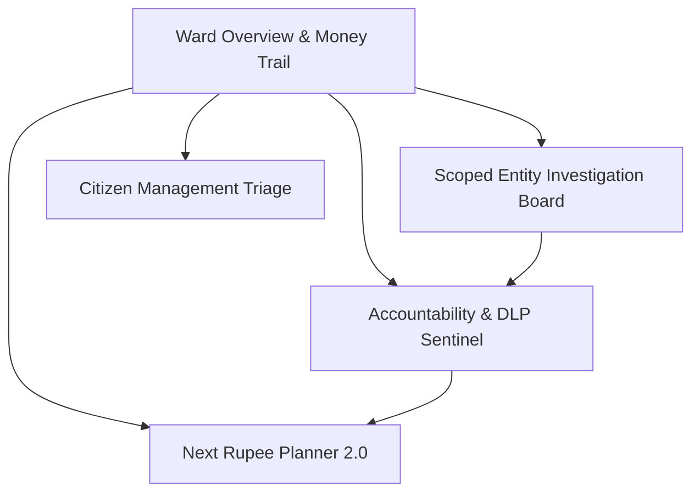

# RupeeTrace — Municipal Officer User Journey & Workflow Specification

## 1. Persona Profile
- **Name**: Er. R. K. Patil
- **Role**: Executive Engineer, Ward K/East (Maintenance & Roads)
- **Primary Goal**: Investigate financial leakages, monitor contractor delivery records, enforce Defect Liability Period (DLP) warranties, simulate capital allocation, and resolve citizen verification disputes.
- **Authentication**: Token-authenticated Officer Session (`rk_patil` / `off_token_demo_patil_2025`).

---

## 2. End-to-End Workflow Stages

### Stage 1: Ward Overview & Money Trail (`/overview`)
- **Macro Financial Health**: ₹0.91 Cr monsoon allocation tracked against billed work orders and repeat repair spending.
- **Top Contractors Share**: Breakdown of ward allocations by empanelled contractors.
- **Leakage Indicators**: Total repeat expenditure on roads under active 2-year warranty.

### Stage 2: Scoped Entity Investigation Board (`/investigate`)
- **No Global Hairballs**: Investigation must start from a specific municipal entity.
- **6 Investigation Modes**:
  1. *Road Asset* (e.g. `RD0140`): Center on road, radiating to connected work orders, contractors, complaints, and audits.
  2. *Work Order* (e.g. `WO25-00600`): Center on repair contract, exposing cost variances (+129.5%), rate cards, and contractor entity.
  3. *Contractor* (e.g. `CT01`): Center on contractor, revealing ward concentration, active road contracts, and audit flags.
  4. *Citizen Complaint* (e.g. `BMC25-000005`): Center on complaint, tracing to linked road and subsequent repair work order.
  5. *Ward Budget* (e.g. `K/E`): Center on ward allocation, radiating to major road projects and contractors.
  6. *Audit Finding* (e.g. `AUD-01`): Center on irregularity, linking to flagged work orders and responsible contractors.
- **Interactive Capabilities**: Radial 1-hop layout, "Expand Connections" button for progressive disclosure, zoom/pan controls, right-side contextual inspector, and alternate Forensic Table view.
- **ML Candidate Toggle**: Off by default; when enabled, displays ML-detected semantic duplicate complaints or unlinked repairs using dashed crimson lines with explicit confidence scores and disclaimers.

### Stage 3: Accountability & DLP Sentinel (`/accountability`)
- **DLP Sentinel**: Algorithmic triage of work orders sanctioned on roads with active contractor warranties.
- **Audit Findings**: Rate-card deviations, duplicate payments, and unbonded edge failures.
- **Contractor Intelligence**: Scorecards ranking contractors by historical defect rate, warranty compliance, and cost variance.
- **Tender Evaluation Advisor**: Automated scoring of prospective bidders based on past delivery performance.

### Stage 4: Next Rupee Planner 2.0 (`/next-rupee`)
- **Budget Simulator**: Interactive sliders adjusting ward capital allocation.
- **Knapsack Optimization**: Multi-criteria project prioritization balancing traffic volume, defect severity, and JANMAT citizen votes.
- **IRC Material Intelligence**: Cost-optimization alternatives (e.g. White-topping vs Bituminous Overlay) with lifecycle cost savings.

### Stage 5: Citizen Management Triage (`/citizen-mgmt`)
- **Case Review**: Triage citizen complaints with road asset and photo evidence.
- **Official Response Dispatch**: Issue binding municipal directives (e.g., rectification under warranty clause 14).
- **Discrepancy Adjudication**: Resolve citizen verification flags to withhold or release contractor retainage escrows.
